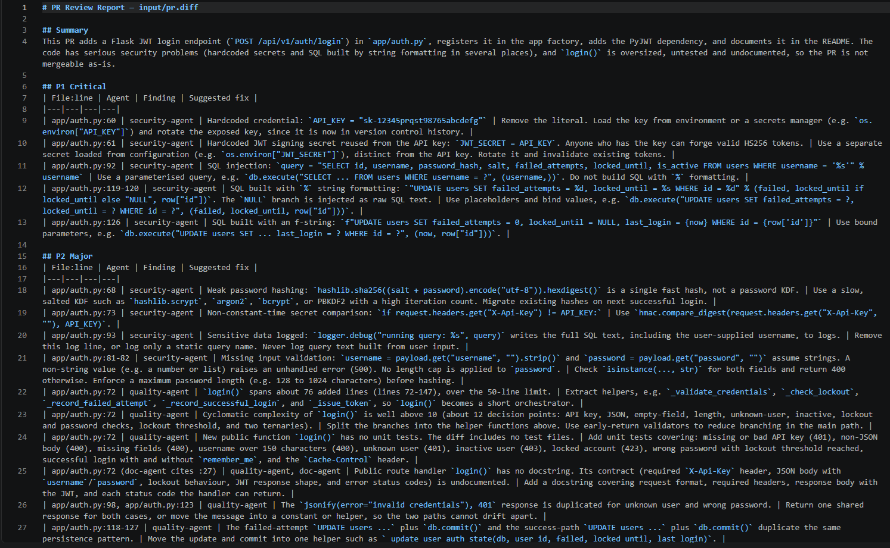

# pr-review-assistant

PR Review Assistant analyses a GitHub PR diff (`input/pr.diff`) and produces a severity-rated code review report (P1 Critical, P2 Major, P3 Minor) saved to `output/review_report.md`. Three parallel sub-agents (security, quality and documentation) scan the diff using the fast haiku model, and a coordinator session running sonnet merges their findings into a single report with a summary and a merge GATE line. To run it interactively, start Claude Code in this folder and enter `/review input/pr.diff`; to run it headlessly (for scripts or CI), use `claude -p "/review input/pr.diff" --permission-mode acceptEdits`. Generated files are only ever written to `output/`.

## Screenshot

